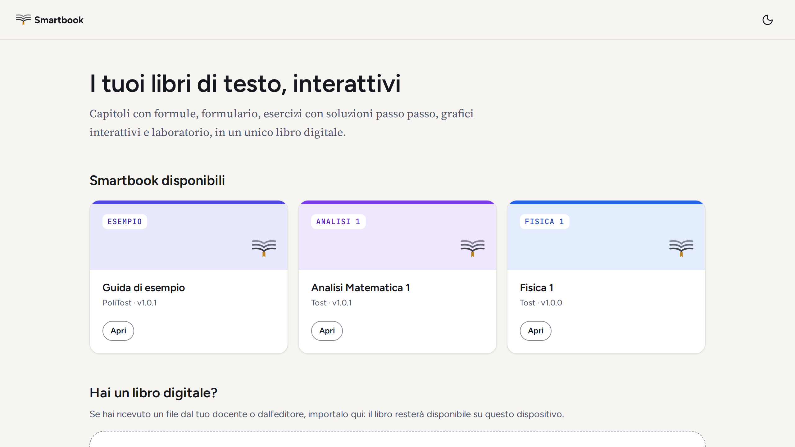
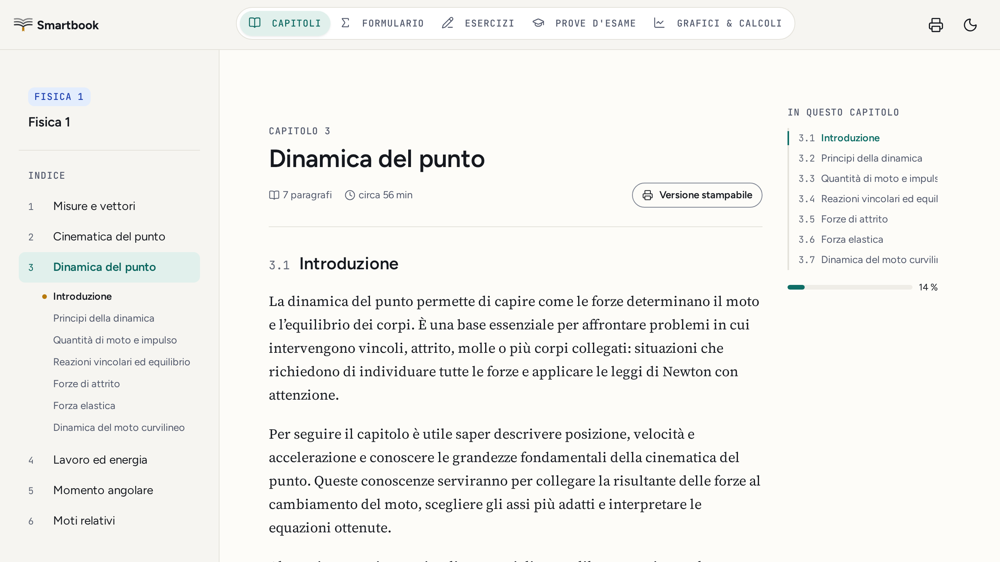

<p align="center">
  <picture>
    <source media="(prefers-color-scheme: dark)" srcset="docs/assets/ptsb-lockup-dark.svg">
    
  </picture>
</p>

<p align="center">
  The free PoliTost smartbooks, one folder of Markdown chapters per book.<br>
  Read them in the browser with no account, or fix and add books with a pull request.
</p>

<p align="center">
  <a href="https://github.com/SuperTost100/politost-books/actions/workflows/check.yml"></a>
  <a href="LICENSE-CONTENT"></a>
  <a href="LICENSE"></a>
</p>

<p align="center">
  <a href="#use-it">Use it</a> ·
  <a href="https://politost.it/reader">Open the reader</a> ·
  <a href="CONTRIBUTING.md">Contributing</a>
</p>

<picture>
  <source media="(prefers-color-scheme: dark)" srcset="docs/screenshots/reader-library-dark.png">
  
</picture>

## What's in it

Every book is a set of chapters. Most add exercises, past-exam practice and interactive graphs, which the reader shows as tabs. The books are in Italian.

| Book                                    | Chapters | Also has                     |
| --------------------------------------- | -------- | ---------------------------- |
| [Analisi Matematica 1](books/analisi-1) | 11       | Exercises, exams, graphs     |
| [Fisica 1](books/fisica-1)              | 14       | Exercises, exams, graphs     |
| [Guida di esempio](books/esempio)       | 3        | Every file type, incl. a lab |

`books/esempio` uses every file the format allows. It is the quickest way to see the syntax before you write your own.

<table>
  <tr>
    <td width="50%">
      <picture>
        <source media="(prefers-color-scheme: dark)" srcset="docs/screenshots/reader-chapter-dark.png">
        
      </picture>
    </td>
  </tr>
  <tr>
    <td>A chapter from this repository in the reader, with tabs for the formulario, exercises, exams and graphs.</td>
  </tr>
</table>

## Use it

**Read online.** Open [politost.it/reader](https://politost.it/reader) and press Apri on a book. The reader needs no account. It downloads the book when you open it and keeps a copy in your browser.

**Download a book.** Every book is a `.ptsb` file at `https://books.politost.it/books/<id>@<version>.ptsb`, for example [`fisica-1@1.1.0.ptsb`](https://books.politost.it/books/fisica-1@1.1.0.ptsb). The [index page](https://books.politost.it) lists them. You can import one into the reader, or into [Pyxis](https://github.com/SuperTost100/politost-pyxis), which keeps its chapters and exercises.

**Read the Markdown.** Each chapter in `books/<id>/chapters/` is a plain Markdown file that renders on GitHub.

**Fix or add a book.** [CONTRIBUTING.md](CONTRIBUTING.md) covers the folder layout, the checks and how to preview a book in the reader before you open the pull request.

## How it works

Anyone with a GitHub account can add a book or fix one. Readers need no account.

1. **You write.** A book lives in `books/<id>/`: `smartbook.json`, one Markdown file per chapter, and optional exercises, exams, lab snippets, graphs and images. The format is in the [content spec](https://github.com/SuperTost100/politost-content/blob/main/spec/content-format.md).
2. **CI checks.** `npm run check` runs the same validation the reader runs on import, so a book that passes here opens there. A pull request that changes a book must also raise its `version`.
3. **CI packs a preview.** Each pull request uploads the packed `.ptsb` of the books it changes as a workflow artifact. Reviewers import it into the reader with the upload button.
4. **Merge publishes.** Cloudflare Pages builds `main` and serves `catalog.json`, the packages and a plain index page at `books.politost.it`.
5. **Search engines read the HTML.** The build also renders every chapter, the formulario, the exercises and the exams as plain HTML. The reader's Worker puts that HTML into the page it sends for `politost.it/reader/libro/<id>/...`, so Google, Bing and AI crawlers, which don't run the reader's JavaScript, read the book at its own URL.

There is no server and no database. The books site is static files, and the reader runs in the browser.

## Development

You need Node.js 22 or newer. CI runs Node.js 24.

```bash
git clone https://github.com/SuperTost100/politost-books.git
cd politost-books
npm ci
npm test         # tests for the scripts
npm run check    # validate every book
npm run build    # pack every book into dist/
```

`npm run build` writes:

```text
dist/
├── catalog.json                  # what the reader fetches
├── books/esempio@1.0.1.ptsb      # one package per book, named id@version
├── covers/                       # only for books with a cover.svg
├── library.json                  # every book and page, with titles and descriptions, for the reader's Worker
├── pages/esempio@1.0.1/          # the book as HTML for the reader's Worker
│   ├── capitolo/<chapter>.html   # plus <chapter>.md for agents that ask for Markdown
│   ├── formulario.html, esercizi.html, esami.html
│   └── assets/                   # the book's images
├── index.html                    # the list at books.politost.it
└── _headers                      # CORS and caching for Cloudflare Pages
```

Both scripts take `--base <ref>`. `check` then also enforces the version bump against that ref, and `--only-changed` limits either script to books changed since it.

```bash
npm run check -- --base origin/main
npm run build -- --only-changed --base origin/main
```

Packages and pages are cached for a year under their `id@version` name, and `catalog.json` pins the sha256 of each package. `build` sets the package timestamp to the last commit that touched the book, so building the same commit twice gives identical files.

## Deployment

Cloudflare Pages project `politost-books`, connected to this repository. Pushes to `main` build with `npm run build` and publish `dist/`, served at `books.politost.it`. GitHub Actions runs the checks on every pull request. Publishing needs no Cloudflare token in GitHub.

Every file on `books.politost.it` is sent with `X-Robots-Tag: noindex`. The books are indexed at `politost.it/reader`, so this host shouldn't compete with it in search results.

## License

This repository has two licenses.

| What                  | License                                                                    |
| --------------------- | -------------------------------------------------------------------------- |
| The books in `books/` | [CC BY-SA 4.0](LICENSE-CONTENT), unless a book's own folder says otherwise |
| The scripts           | [MIT](LICENSE)                                                             |

You can share and adapt the books with credit, under the same license. Don't add textbook pages, lecture slides or exam texts you don't own.
